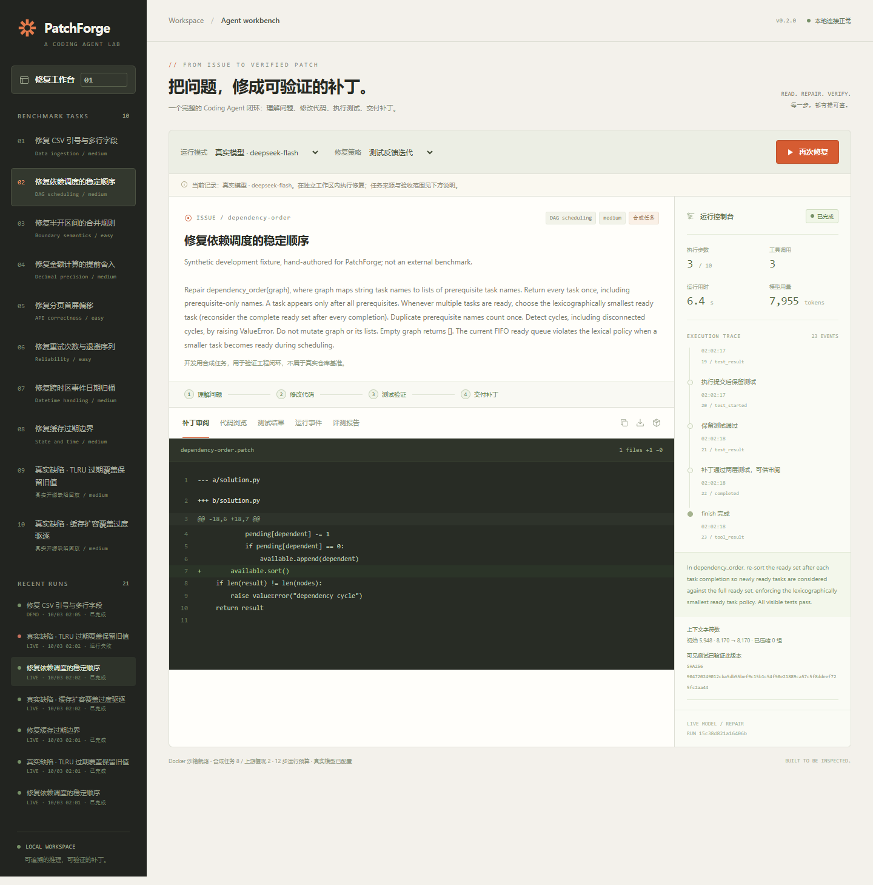
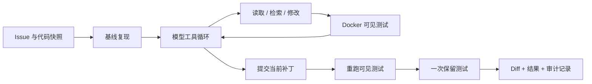

# PatchForge · 从 Issue 到经过测试的补丁

[](https://github.com/mrsadsad/patchforge-agent/actions/workflows/test.yml)

一个能**真正改代码、在 Docker 中跑测试、根据执行反馈继续修复**的 Coding Agent。面向 Agent 应用与平台研发作品集：模型负责选择和调用工具，运行时负责权限、预算、测试与结果留存。它与 OpsLens 的只读故障调查是两个独立项目。

当前版本 **0.2.0**：支持有界源码检索与 AST 符号索引、按行读取、完整工具回合压缩、批量修改回滚、检查点、代码版本绑定验证及带 SHA-256 清单的 ZIP 审阅包。除八项合成开发任务外，加入两项保留原始源码与许可证的 **cachetools 历史缺陷回放**。公开历史任务不是盲测，也不是 SWE-bench。



本轮 **74 项软件测试、14 项浏览器检查通过**，完成 **20 次真实模型重复对照**；[本轮实验](docs/EXPERIMENT_V02.md)按合成与开源来源分别报告成本和失败。首版结果仍保留在 [首轮记录](docs/EXPERIMENT.md)。功能变化见 [0.2 升级记录](docs/UPGRADE_V02.md)，运行验收见 [验证记录](docs/VALIDATION.md)。

## 快速运行

需要 Python 3.11+ 与已启动的 Docker Desktop（Linux containers）。在**本项目目录**运行：

```powershell
git clone https://github.com/mrsadsad/patchforge-agent.git
cd patchforge-agent
docker pull python:3.12-slim
python -m forge doctor
python -m forge serve --port 8771 --runs runs/v02
```

打开 [0.2 工作台](http://127.0.0.1:8771/)，选择任务和“固定脚本演示”。演示应用参考补丁，但基线失败与修复后测试均真正由 Docker 执行，不代表模型能力。源码页支持查看原始与当前代码，测试页绑定具体代码摘要，下载按钮提供 diff 与可校验的完整审阅包。

真实模型：复制 `.env.example` 为 `.env`，填写 `PATCHFORGE_API_KEY`。也可以显式选择已有 DeepSeek 配置文件，避免复制密钥：

```powershell
python -m forge doctor --env-file ../.env
python -m forge serve --port 8771 --runs runs/v02 --env-file ../.env
```

模型配置仅在服务端读取，不发给浏览器或测试容器。默认 `deepseek-flash`，兼容 Chat Completions 的服务可通过 `PATCHFORGE_BASE_URL`、`PATCHFORGE_MODEL`、`PATCHFORGE_API_KEY` 配置；其他供应商尚未实测。当前按**源码项目**运行，任务数据位于项目 `tasks/`，不提供包含所有任务的独立 wheel 分发。

新克隆的仓库使用本项目 `.env` 即可，不需要示例中的父目录配置；`--env-file ../.env` 仅用于本机已有凭据的情况。第三方源码与许可证见 [THIRD_PARTY_NOTICES.md](THIRD_PARTY_NOTICES.md)。

## 这次 Agent 实际做什么

1. 为任务建立独立代码副本，先运行不可修改的可见测试复现失败。
2. 让模型读取代码、检索文件、执行唯一匹配的文本修改。
3. 在禁网、只读文件挂载、资源受限的容器内运行可见测试，把失败反馈返回模型。
4. 提交时强制验证**当前版本**；可见测试通过后执行一次保留测试。保留测试输出不会返回修复循环。
5. 保留 diff、测试输出、请求次数、token 用量、延迟和失败原因，供人工审阅。



## 对照评测

```powershell
python -m unittest discover -s tests -v
python -m forge run --task dependency-order --mode live --max-steps 8 --env-file ../.env
python -m forge evaluate --tasks upstream-cachetools-expired-overwrite upstream-cachetools-growing-entry --mode live --max-steps 10 --repeats 2 --max-model-calls 44 --runs runs/my-evaluation --env-file ../.env
```

上述命令为两项开源任务 × 两种策略 × 两次重复，预检最坏请求上限为 44。`direct` 接收同样的初始源码片段和基线失败输出，一次提交修改；`repair` 最多十轮工具交互，可读取遗漏代码并获取执行反馈。两者最终验证规则相同，预算不同。顺序按 seed 打乱，失败与预算耗尽保留在分母；重复尝试不会当成新的独立任务。报告按数据来源分组，保存每次尝试、原字节任务、源码快照与镜像 ID；源码或任务指纹变化时拒绝继续混入成绩。

模型步数与工具数有硬限制；`max_tokens` 是每次输出上限，不是金额预算。请求失败可能已计费；用量缺失显示未知。正式比较不应把固定脚本 demo 成绩混入模型结果。

工作台和 CLI 使用各自的 `--runs` 目录，或先完成 CLI 评测再启动工作台。操作系统文件锁会拒绝同目录的第二个运行器，防止误把另一个进程的任务标记为中断；当前仍是单进程本地服务。

## 目录与技术重点

| 文件 | 负责什么 | 可以讨论的问题 |
| --- | --- | --- |
| `forge/runtime.py` | 工具循环、提交门控、取消、预算 | 如何避免拿旧版本测试结果提交新代码？ |
| `forge/repository.py` | 路径边界、精确修改、diff | 为什么不直接给模型任意 shell？ |
| `forge/context.py` | 符号索引、相关片段、完整回合压缩 | 如何保证压缩后没有孤立的工具结果？ |
| `forge/artifacts.py` | 可重现 ZIP、前后源码与校验清单 | 下载的补丁对应哪次测试与哪个版本？ |
| `forge/sandbox.py` | Docker 资源限制与测试执行 | 容器隔离与评测防作弊为什么不同？ |
| `forge/provider.py` | 原生工具协议、错误脱敏、用量 | 缺失 token 用量为什么不能记作零？ |
| `forge/store.py` | SQLite 原子状态记录 | 中断请求怎样保留不确定性？ |
| `forge/evaluation.py` | 单轮/多轮对照、失败留存、快照 | 成功率相同但成本更高，结论该怎么写？ |
| `forge/importer.py` | 受限 Python 仓库任务导入 | 如何控制上下文和测试泄漏？ |
| `forge/web/index.html` | 任务、补丁、测试与轨迹工作台 | 如何让执行过程可审阅？ |

## 明确边界

- 支持小型、无第三方依赖的 Python unittest 任务；没有联网安装依赖或任意终端执行，也没有自动提交、推送或上线。
- 不宣称多 Agent、RAG、MCP 或训练优化已经实现。自写工具循环用于把执行与评测机制讲清楚。
- 容器隔离宿主机，但测试与被测代码仍共用 Python 进程；恶意代码可能影响测试框架。本版本不是抗对抗评测沙箱，补丁仍需人工审阅。
- 保留测试只对单次修复循环不可见，不是独立盲测数据。八项合成样例与两项公开历史缺陷均不能证明真实仓库泛化；公开修复可能已出现在模型训练数据中。
- 服务仅供本机使用，最多两个执行 worker、八项活动任务。没有公网鉴权、多租户、分布式队列或生产 SLA。
- 重启会把未完成任务标记为 interrupted 并保留已写入的状态和代码；不自动继续未确认的模型调用。

[架构与取舍](docs/ARCHITECTURE.md) · [真实实验记录](docs/EXPERIMENT.md) · [导入自己的仓库](docs/IMPORT.md) · [字节岗位映射](docs/JOB_ALIGNMENT.md) · [演示与面试练习](docs/INTERVIEW.md)
